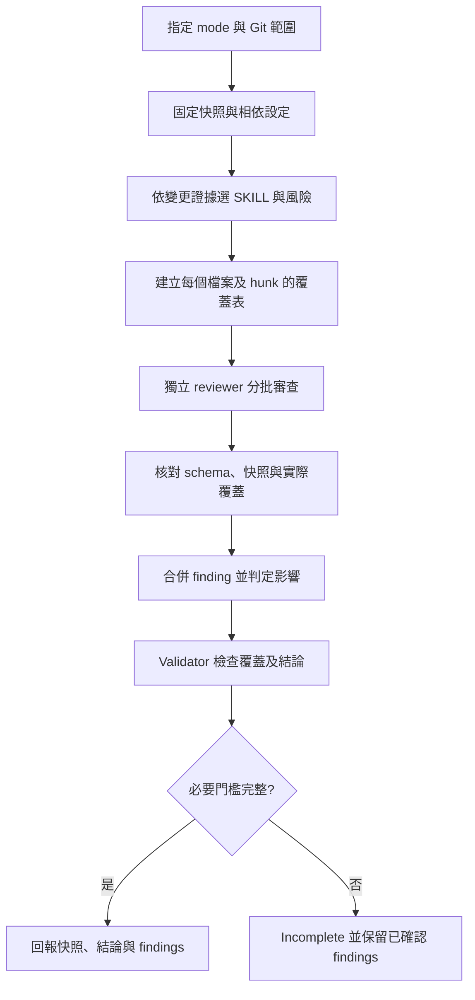

# VS Code Chat Custom Agents 中文使用指南

本文件說明何時選擇 user-facing Custom Agent、應附加哪些 Markdown，以及建議的輸入格式。安裝位置與 VM 移植方式請參考 [`VS_CODE_CHAT_SETUP.zh-TW.md`](./VS_CODE_CHAT_SETUP.zh-TW.md) 與 [`VM_COPY_GUIDE.zh-TW.md`](./VM_COPY_GUIDE.zh-TW.md)。

## 使用原則

本 catalog 只有以下三個 user-facing Agents：

| Agent | 適用情境 | 最重要的輸入 |
|---|---|---|
| Frontend Implementation | 執行已核准的計畫 | 已核准計畫、驗收條件、允許修改範圍 |
| Frontend Review | staged、heavy staged 或 branch review | 明確 review mode 與 Git scope |
| VS Code Skill Creator | 建立或改善 Agent Skill | Skill 目標、正負觸發例、目的位置 |

`Frontend Implementer`、`Frontend Reviewer` 等 worker 設定為 `user-invocable: false`。不要在 Agent picker 直接尋找或選擇它們；coordinator 會透過 `agent/runSubagent` 呼叫。

## 如何提供 Markdown

推薦把本次任務資料寫成獨立 Markdown，例如：

```text
docs/tasks/TASK-123.md
```

然後在 VS Code Chat：

1. 選擇適合的 Custom Agent。
2. 使用 Chat 的附件／Add Context 功能加入該 Markdown，或在訊息中提供清楚的 workspace-relative path。
3. 貼上本文件對應的輸入模板。

只需要附加本次任務、計畫或錯誤證據。不要重複附加 `skills/**/SKILL.md` 或 workflow reference；Agent 會從已安裝的 catalog 載入它們。

不要在 Markdown 中放 API key、token、cookie、password、private key 或 connection string。

## 共用輸入欄位

複雜任務建議包含：

```markdown
# Goal
<!-- 要完成什麼，以及使用者可觀察到的結果 -->

# Context
<!-- 相關頁面、component、route、API、設計或 issue -->

# Relevant paths
<!-- workspace-relative paths；未知可寫「請先調查」 -->

# Current behavior
<!-- 現在發生什麼 -->

# Expected behavior
<!-- 應該發生什麼 -->

# Constraints
<!-- 不可改的 API、相容性、套件、設計、時程或安全限制 -->

# Acceptance criteria
- [ ] 可驗證條件 1
- [ ] 可驗證條件 2

# Verification
<!-- 期望執行的 test、lint、typecheck、build -->

# Output
<!-- 希望得到計畫、實作、finding report 或 Skill package -->
```

缺少的 Repository 事實可以要求 Agent 先調查；不要為了填滿模板而猜測。

---

## Frontend Implementation

### 何時使用

已經有明確且核准的 implementation plan，需要依序實作、驗證與 review 時使用。需求與可執行計畫應先補齊，再交由此 Agent 實作。

### 建議附件

- 已核准計畫，例如 `docs/plans/TASK-123-plan.md`
- 原始需求或 acceptance criteria
- 前次 review findings（若是修正回合）

### 最小輸入

```text
請實作附件 TASK-123-plan.md 中已核准的計畫。
只修改計畫允許的範圍，執行其中的驗證，完成後回報實際修改、命令結果與剩餘風險。
不要 commit 或 push。
```

### 完整輸入模板

```markdown
請執行 Frontend Implementation。

## Approved plan
- 附件：`docs/plans/TASK-123-plan.md`
- 計畫狀態：已核准

## Allowed changes
- `src/...`
- `tests/...`

## Forbidden changes
- 不修改：`...`
- 不新增 dependency／不改 API contract／其他限制

## Acceptance criteria
- [ ] ...
- [ ] ...

## Required verification
- `npm run lint`
- `npm run typecheck`
- `npm test -- ...`

## Git authorization
- 允許修改檔案：是
- 允許 commit：否
- 允許 push：否
```

若需要 commit 或 push，必須在輸入中另外明確授權。

---

## Frontend Review

使用時必須明確指定一種 mode。

### 這次 SKILL 升級後的流程

三種 mode 共用[審查契約](../skills/frontend-staged-review-workflow/references/review-contract.md)，各自保留 Git 範圍與 reviewer 數量。Agent 會自行讀取契約，使用者不需要額外附加。



| 項目 | Staged | Heavy staged | Branch |
|---|---|---|---|
| 審查內容 | 固定的 cached diff 與 index blobs | 同 staged | 固定 merge-base → source 的 committed diff |
| 每個選定 SKILL／風險範圍 | 至少兩個獨立完成的 reviewer | 預設五個；明確設定可調整，最低兩個 | 至少兩個獨立完成的 reviewer |
| Aggregation validator | 一次有效 pass | 預設兩次有效 pass | 一次有效 pass |
| 審查中版本改變 | HEAD／index 改變則 Incomplete，另開新回合 | 同 staged | 繼續審查已固定 SHA，明確回報版本 |

人數與覆蓋必須同時達標。例如 A 只看表單、B 只看翻譯，不代表兩個檔案都被審查兩次。大型 diff 會分組，每組仍須達到該 mode 的獨立審查門檻。重試取代舊 attempt；看過其他 reviewer 結論的仲裁 pass 不補入獨立人數。

### 升級後的 SKILL 選用

基礎審查固定使用 `code-review-and-quality`；其他 SKILL 需要實際變更與具體風險，不會因為有 TSX 檔案就全部啟用。重疊規則若已被選定 SKILL 涵蓋，會記錄原因並避免重複派工。

| 變更證據 | 使用 SKILL | 新版審查重點 |
|---|---|---|
| 表單的 values、reset、subscription、submit 或 Zod schema | [react-hook-form-zod](../skills/react-hook-form-zod/SKILL.md) | dirty 欄位與背景刷新、儲存／取消後的基準、切換資料身分、數字空值與 input/output 型別、非同步送出 |
| 翻譯 key、locale、格式或初始化 | [internationalization-i18n](../skills/internationalization-i18n/SKILL.md) | 保留現有框架及訊息格式，檢查 namespace、插值、複數、初始化與 server/client 邊界；CLI status 不代表譯文品質 |
| 頁面層級、密度、版型或明確設計 critique | [frontend-design](../skills/frontend-design/SKILL.md) | 依 Persuade／Operate／Read／Experience 判斷；尊重既有 token、內容與核准設計，不以個人美感要求重做 |
| 互動、文案、響應式行為 | [web-design-guidelines](../skills/web-design-guidelines/SKILL.md) | 針對實際變更及專案慣例，與設計 SKILL 有不同問題時才同時派工 |
| 已修改行為測試，或明確要求檢查 TDD 品質 | [test-driven-development](../skills/test-driven-development/SKILL.md) | 從公開介面觀察行為、獨立推導預期值，找出掩蓋錯誤的 assertion／mock；不要求一律新增測試或追求覆蓋率 |

SKILL 內的實作步驟在 review 中只作為判斷準則，不會觸發改檔、instrument、extract、安裝套件或寫入工作目錄的驗證。這次不加入已排除的瀏覽器測試、無障礙專項或動畫效能流程。沒有對應畫面證據時，不會宣稱已驗證實際視覺效果。

### Staged mode

只 review `git diff --cached`。未 staged、untracked 與 branch history 都不在範圍。

Agent 會固定 HEAD、index manifest 與 blob IDs；需要完整檔案時，讀取固定的 index blob，不把尚未 staged 的內容混入。最終結論附上審查快照識別。

```markdown
請使用 Frontend Review 的 staged mode。

## Scope
- 只檢查：`git diff --cached`
- 排除 unstaged／untracked：是

## Focus
- correctness
- maintainability
- 表單／翻譯／互動生命週期（有對應變更時）
- security/privacy（如適用）

## Output
回報審查快照、結論與具體 findings，附檔案與行號。
不要修改檔案，不要提出只有新增 unit test 的建議；已修改測試中的實際錯誤仍須審查。
```

### Heavy staged mode

適合風險高、改動大、release 前或需要高冗餘 reviewer quorum 的 staged diff。

```markdown
請使用 Frontend Review 的 heavy staged mode。

## Scope
- 只檢查：`git diff --cached`

## Reason for heavy review
<高風險原因，例如 auth、payment、permission、large refactor>

## Required emphasis
- <特別需要深查的 component／風險>

## Review budget
- 使用預設每個風險範圍五個有效 reviewer、兩個 aggregation validator
- 大型 diff 可分組；每組仍維持門檻

## Output
維持完整 reviewer quorum 與 validator passes；若無法達成，標示 Incomplete，不要降低標準後宣稱完成。
```

### Branch mode

比較 source branch 相對 target branch 真正引入的 committed contribution。

```markdown
請使用 Frontend Review 的 branch mode。

## Git refs
- Source：`feature/example`
- Target：`master`
- 允許 non-destructive fetch target：是

## Scope
只 review pinned merge-base 到 pinned source SHA 的 committed diff。
排除 index、working tree、untracked files 與 target-only changes。

## Focus
- correctness
- regression risk
- architecture
- security/privacy（如適用）

## Output
回報 source、target、merge-base short SHA、verdict，以及具有檔案與行號的具體 findings。
```

Review Agent 永遠是 read-only；不要要求它順便修正。需要修正時，把 findings 交給 `Frontend Implementation`。

### 如何判讀結果及接續修正

- `Approve`：指定快照內沒有具體 findings，且範圍、覆蓋、人數與必要 validator 全部達標；不代表未執行的測試或視覺檢查已通過。
- `Request changes`：完成審查，存在具體且阻擋合併的 critical／high 問題。
- `Comment`：完成審查，存在其他具體問題。
- `Incomplete`：快照、上下文、覆蓋、人數或必要 validator 有缺口；仍列出已確認問題，不把「沒有發現」當作通過。
- `Degraded`：使用者明確接受未達完整標準的結果；必須揭露缺口，不能改標 `Approve`。

修正交接至少保留：審查快照／branch SHAs、finding、觸發條件、影響及預期行為。Implementation 依授權修正並執行相應驗證；之後以新快照重新 review，核對原問題及修正引入的影響，不沿用舊快照的通過結論。Review 本身不會自動開始修正或 commit。

---

## VS Code Skill Creator

### 何時使用

建立新的 Agent Skill、改善既有 Skill 的觸發描述，或用正負 query 評估 routing precision/recall 時使用。

### 建議附件

- 目標 Skill 的初稿或既有 `SKILL.md`
- 必須保留的 references／scripts／templates
- 正向與負向觸發範例

### 最小輸入

```text
請建立一個名為 `<skill-name>` 的 Agent Skill，安裝目標是 `~/.copilot/skills/<skill-name>/`。
用途：<用途>。
先定義正向與負向觸發 query，完成 validation 與 holdout evaluation 後再回報最佳 description。
```

### 完整輸入模板

```markdown
請執行 VS Code Skill Creator。

## Skill identity
- Name：`<lowercase-kebab-case>`
- Target：`~/.copilot/skills/<skill-name>/`
- Purpose：...

## Must trigger for
- ...
- ...

## Must not trigger for
- ...
- ...

## Required resources
- references：...
- scripts：...
- templates：...

## Constraints
- 支援平台：Ubuntu／Windows／macOS
- 不允許：未確認的 CLI、load-time command、credentials
- Provenance／license：...

## Acceptance criteria
- frontmatter validation 通過
- relative resources 可解析
- training 與 holdout query 分離
- 回報 routing errors 與最佳 description
```

---

## 不需要選 Agent 的工作

下列工作直接使用 Agent Skill，比建立或選擇 Custom Agent 更合適：

### 產生 staged commit subject

```text
/frontend-staged-commit-message
```

建議輸入：

```text
/frontend-staged-commit-message
請只根據目前的 git diff --cached 產生至少五個英文 Conventional Commit subjects。
先簡短解釋 staged changes 的主要意圖、commit type 選擇、候選細節如何遞增，以及是否需要拆分 commit。
每個選項各占一行，從最簡短的安全描述依序增加到最詳細、但仍受 staged diff 支持的描述。
不要 stage、commit 或修改檔案。
```

其他單次、確定性、沒有特別工具邊界、handoff 或多 worker 編排的工作，也應優先使用 Skill，而不是新增 Agent picker 項目。
